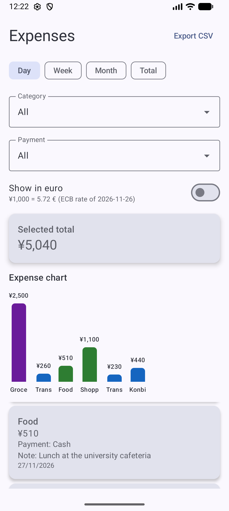
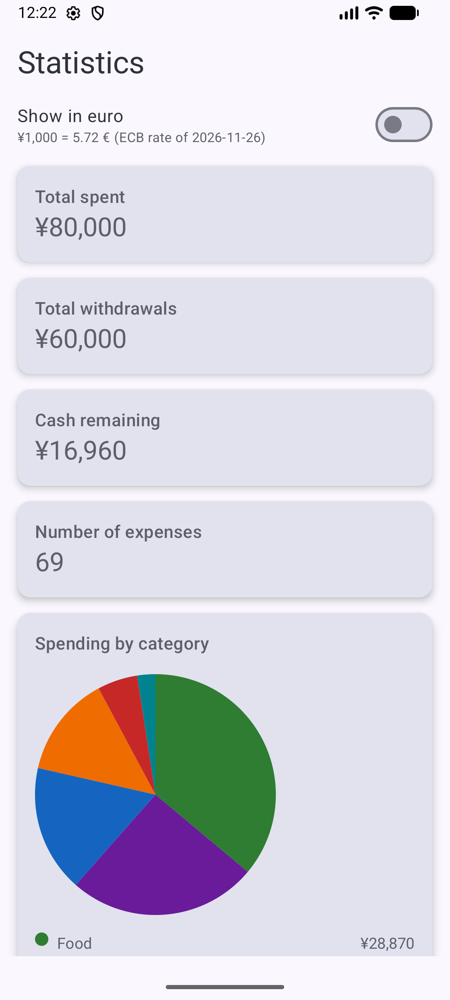
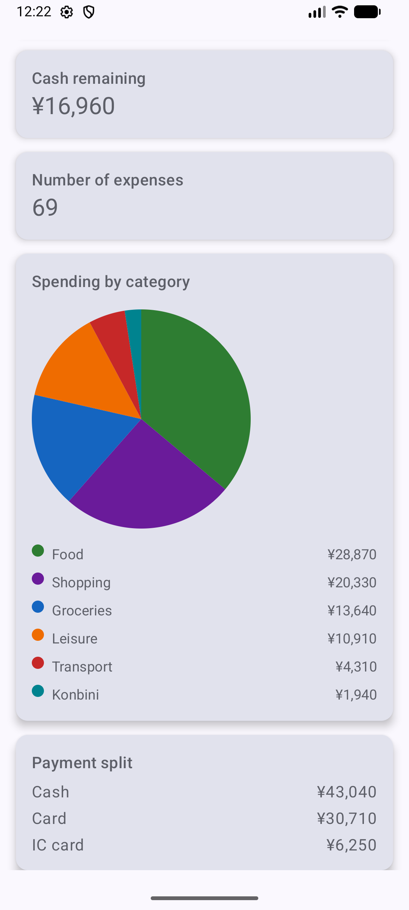
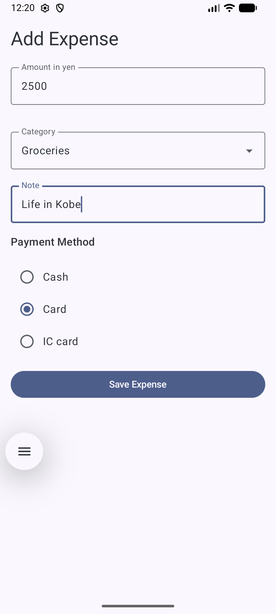

# Japan Expense Tracker (Android)

[](https://github.com/Aymeric-Dcn/JapanExpenseTracker-Android/actions/workflows/android.yml)


An expense tracker for living in Japan, built with Kotlin and Jetpack Compose.
Its main feature: **hold a Suica or Pasmo card against the phone to read its balance and
import the train fares and shop payments as expenses**, using the FeliCa protocol over NFC.

I built it for my robotics internship in Osaka (2026), where most daily spending went
through cash and a transit IC card.

<p align="center">
  
  
  
  
</p>

## Download

Get the signed APK from the [latest release](https://github.com/Aymeric-Dcn/JapanExpenseTracker-Android/releases/latest)
(Android 7.0+). Releases are built and published by GitHub Actions when a version tag is pushed.

## Features

- **IC card reading (Suica, Pasmo, ICOCA...)**: balance and last 20 transactions, read over
  NFC-F without any key. Payments become expenses in one tap, top-ups are ignored, and a
  card can be scanned again without creating duplicates.
- **Cash tracking**: ATM withdrawals minus cash expenses gives the cash left in the wallet,
  with a low-cash warning.
- **Live JPY → EUR rate**: daily European Central Bank reference rate from the
  [Frankfurter API](https://frankfurter.dev), cached for offline use.
- **Filters**: day / week / month / total, category, payment method (cash, card, IC card).
- **Statistics**: totals, payment split, spending by category (pie chart drawn with Compose `Canvas`).
- **Edit and delete** any expense.
- **CSV export** of the filtered expenses, UTF-8 with BOM so Excel shows Japanese notes correctly.

## How the IC card reading works

Japanese transit cards use Sony FeliCa (JIS X 6319-4, NFC-F). Their transaction history is
stored in service `0x090F`, which can be read without authentication.

```
Phone                                         Card
  | -- Read Without Encryption ------------------> |
  |    LEN 06 IDm(8) 01 0F09 0A 8000 8001 ... 8009 |   service 0x090F, blocks 0-9
  | <------------------------------------------ -- |
  |    LEN 07 IDm(8) 00 00 0A [10 x 16 bytes]      |   status OK, 10 history blocks
```

Each 16-byte block holds one transaction: date (7-bit year, 4-bit month, 5-bit day),
process type (fare, top-up, purchase...), and the balance after the transaction in little
endian. The card stores no amounts, so the app computes each one as the difference between
two consecutive balances.

The protocol code lives in its own Gradle module, [`felica`](felica/src/main/kotlin/com/aymeric/felica),
written in pure Kotlin with no Android dependency:

- `FelicaCommands` builds the command frame and validates the response (length, response
  code, IDm, status flags);
- `SuicaHistoryParser` decodes the blocks into balance and transactions.

Android only appears in [`SuicaReader`](app/src/main/java/com/aymeric/japanexpensetracker_android/data/nfc/SuicaReader.kt),
which sends the frames through `NfcF.transceive()`. As a result, all the decoding is unit
tested on the JVM with frames built from the documented layout, and the module could be
reused as is in a Kotlin Multiplatform app.

> The process type codes are not published by JR East. The mapping follows the tables
> documented by the FeliCa community and only covers the common cases; unknown codes are
> shown as "Other".

## Architecture

```
felica/                  Pure Kotlin: FeliCa frames, Suica history decoding (+ tests)
app/
  data/
    local/               Room database, DAOs, migration v1 -> v2
    nfc/                 SuicaReader (NfcF I/O)
    remote/              Frankfurter response parser
    repository/          Expenses, exchange rate with offline cache
  domain/
    model/               PaymentMethod, ExchangeRate
    usecase/             Cash remaining, filters, IC card import
  presentation/          Jetpack Compose screens, navigation, ViewModel (StateFlow)
  utils/                 Formatting, date ranges, CSV export
```

- MVVM with `StateFlow`, single-activity Compose navigation.
- Room for persistence. Amounts are stored as whole yen (`Long`); the v1 → v2 migration
  converts the old floating point columns.
- Reader mode (`NfcAdapter.enableReaderMode`) is only active while the scan screen is open.

## Tests and CI

```bash
./gradlew :felica:test :app:testDebugUnitTest
```

- `felica`: command frame layout, response validation (wrong card, error status, truncated
  frame), date and little-endian balance decoding, amount computation.
- `app`: cash remaining, filters (including weeks that span the new year), IC card import
  and de-duplication, currency formatting, CSV escaping, API response parsing.

GitHub Actions runs the tests and builds the debug APK on every push. Pushing a `v*` tag runs
the [release workflow](.github/workflows/release.yml): tests, signed release APK, GitHub release.
The signing keystore is stored as an encrypted repository secret, never in the code.

## Build

Requirements: Android Studio (recent version), JDK 17, an NFC phone to scan cards.

```bash
git clone https://github.com/Aymeric-Dcn/JapanExpenseTracker-Android.git
cd JapanExpenseTracker-Android
./gradlew :app:assembleDebug
```

## Roadmap

- Decode station codes into station names for train fares
- Choose the date when adding an expense, browse past weeks and months
- Receipt scanning

## Related

[JapanExpenseTracker-IOS](https://github.com/Aymeric-Dcn/JapanExpenseTracker-IOS): a SwiftUI
version I use on my own iPhone. It has fewer features: this Android app is the actively
developed one.

## Author

**Aymeric Duchene**, Electronics and Embedded Systems engineering student at Polytech
Montpellier. [GitHub](https://github.com/Aymeric-Dcn)

## License

[MIT](LICENSE)
